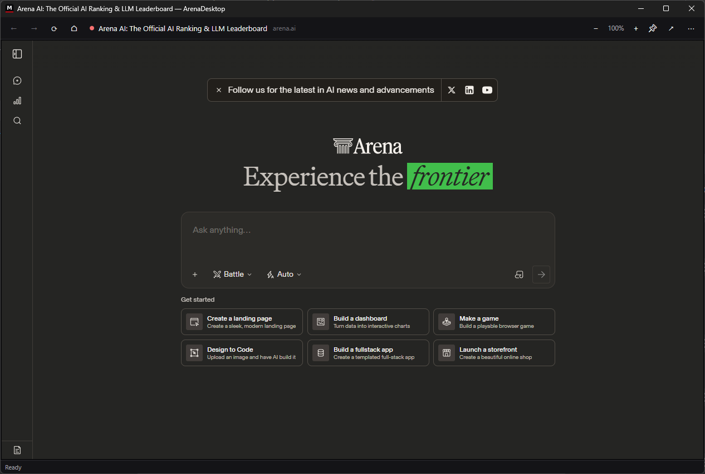

# ArenaDesktop

A native Windows desktop client for [Arena](https://arena.ai) — the AI model battle and leaderboard platform (formerly LMArena).

> ArenaDesktop is an independent open-source project. It is not made by, endorsed by, or affiliated with Arena Intelligence, Inc. "Arena" is their product; this app simply displays arena.ai in a native window.

## TL;DR

Arena has no Windows app, so this is one: a small native program that opens arena.ai in its own window, keeps you signed in, and lives in the system tray. Think of it like giving a website its own house key instead of visiting through the browser every time. It adds the desktop touches a tab can't — one-jump navigation to every part of Arena (Battle, Direct Chat, Side by Side, the Leaderboard, Agent, Image, Code, Video, Web Search), downloads with progress, multiple sign-in profiles, a settings window, and update notices. Free, open source (MIT), no telemetry. You need Windows 10/11 (x64 or ARM64) and the WebView2 Runtime (usually already installed). Download the installer from Releases and run it.

## What you get

- **A real app, not a tab** — its own window, taskbar icon, and Alt-Tab entry; no browser chrome competing for space.
- **Arena modes, one jump away** — Battle, Direct Chat, Side by Side, the Leaderboard, Agent, Image, Code, Video, and Web Search from the ⋯ menu's *Arena modes*, the tray menu, the taskbar Jump List, Ctrl+1…Ctrl+9, the command line, and `arenadesktop://` links. Each one is its own page on arena.ai (addresses verified on the live site); the model used inside Direct Chat and Side by Side is picked at the top of those pages.
- **Stay signed in** — a dedicated WebView2 profile on your PC keeps your Arena session between launches, and the app reopens the last page you were on.
- **Tray support** — the tray menu runs the whole app while it's hidden: Open, Arena modes, Quick dictate, New window, Reload, Downloads, Settings, Switch profile, a web-view status line, and Exit. Closing the window minimizes to the tray by default; after a while hidden the web view can suspend to free memory (never during downloads or after the microphone has been used). A global hotkey (Ctrl+Alt+A, changeable) shows or hides the app from anywhere.
- **Downloads with progress and control** — generated images, files and exports download in parallel with live progress %, estimated time remaining, and speed in the status bar; the taskbar button mirrors overall progress. The Downloads window is a small manager: pause/resume/cancel and retry per download, plus a searchable history with Open / Show in folder / Copy path / Open with… / Delete file. Folder, ask-where-to-save, name-collision behaviour and history size are all in Settings.
- **Multiple accounts** — profiles keep separate Arena sign-ins on one PC, each with its own session data — up to 32. Each can have its own zoom, downloads folder, accent colour and start page; switch from the ⋯ menu, the tray, or Settings, create a desktop shortcut per profile, or launch with `--profile <id>`.
- **Settings window** — one place (Ctrl+,) for startup behaviour, close-to-tray, zoom, downloads, updates and appearance, with a search box, export/import (plain or password-encrypted), reset-with-backup-first, and a one-screen setup wizard on first run.
- **Privacy & security** — clear cookies only, cache only, or all site data, per profile or all profiles, with the consequence stated first; a permissions manager and a counts-only site-data viewer (cookie values are never shown); an optional app lock (password/PIN — it guards the open app, it does not encrypt data on disk, and the app says so); a log viewer that runs a redaction check before you share anything.
- **Recovers instead of dying** — if the page's engine crashes, or your connection drops or the PC sleeps mid-load, the app recovers once per incident (never a reload loop); a page that stops answering gets a banner offering Reload or Wait, never an automatic reload. Safe mode (`--safe-mode`, or hold Shift at launch) starts at the home page with no update check.
- **Updates, in-app** — the app checks GitHub Releases and can download an update with progress, verify its SHA-256 fingerprint against the release's published sums, and install only when you say so — never silently. Snooze, check frequency, Stable / pre-release channels, What's New, and rollback to the previous in-app-updated version are included. The check can be turned off in Settings.
- **Help that stays in the app** — offline Help & troubleshooting pages, a Diagnostics window with a one-click copyable report, a support-bundle export that is previewed file-by-file and uploaded nowhere, and guided microphone and notification tests.
- **Portable mode** — drop an empty `portable.txt` beside `ArenaDesktop.exe` in the zip build and settings, download history, and logs live in a `data` folder beside the exe. (Sign-in data stays in your user profile; see *Where things live*.)
- **Private by construction** — no telemetry, no accounts of its own, no data collection. The only files it writes are its settings, a rolling local log, and the WebView2 profile — all under your user profile, all deletable by you at any time.
- **Forgiving** — second launches wake the running window instead of opening a duplicate; a corrupted settings file is preserved as a backup and defaults are used; load failures explain themselves in plain words and offer a retry.

## Screenshots

Captures come from real runs on Windows. More captures are listed in [docs/screenshots/CAPTURE.md](docs/screenshots/CAPTURE.md) and will be added as they are taken.



## Requirements

- Windows 10 or Windows 11 (x64, or ARM64 — native builds ship for both)
- The Microsoft Edge **WebView2 Runtime** — preinstalled on Windows 11 and most Windows 10 PCs. If it's missing, ArenaDesktop tells you and links you to Microsoft's installer.
- Nothing else: the download is **self-contained** — the .NET 10 runtime is bundled in, so there is no separate .NET install.

## Install

**Installer (recommended):** download `ArenaDesktop-Setup-v0.1.0-x64.exe` (or `-arm64.exe` on a Windows-on-ARM PC) from the [Releases](../../releases) page and run it. It's a per-user install (no admin needed), with a Start Menu shortcut and an entry in Apps & Features for uninstalling. Uninstalling keeps your settings and sign-in data unless you choose to delete them when asked.

**Portable zip:** download `ArenaDesktop-v0.1.0-windows-x64.zip` (or `-windows-arm64.zip`), unzip anywhere, and run `ArenaDesktop.exe`.

Either way: the app is not code-signed, so Windows SmartScreen may warn on first run — choose **More info → Run anyway**.

## How to use it

1. Run ArenaDesktop and sign in to Arena in the window (Google or email, exactly as on the website).
2. Use Arena as normal — Battle is the home experience.
3. Jump around with the ⋯ menu's **Arena modes** (Ctrl+1 Battle, Ctrl+2 Direct Chat, Ctrl+3 Side by Side, Ctrl+4 Leaderboard, Ctrl+5 Agent, Ctrl+6 Image, Ctrl+7 Code, Ctrl+8 Video, Ctrl+9 Web Search).
4. Close the window to park it in the tray; press Ctrl+Alt+A or double-click the tray icon to bring it back.
5. Press F1 or ⋯ → *Help & troubleshooting…* any time — the help works with no internet.

## Where things live

| What | Where |
| --- | --- |
| Settings | `%APPDATA%\ArenaDesktop\settings.json` |
| Download history | `%APPDATA%\ArenaDesktop\downloads.json` (names, sizes, dates, paths, and completed/failed state — never source URLs) |
| Diagnostic log | `%APPDATA%\ArenaDesktop\logs\arenadesktop.log` (URLs are logged host-and-path only, never with query strings) |
| Web profile (login session) | `%LOCALAPPDATA%\ArenaDesktop\WebView2` for the default profile; extra profiles get sibling folders (`WebView2-<id>`) |
| Downloads | Your Downloads folder, or the folder chosen in Settings |

In **portable mode**, Settings, Download history, and the Diagnostic log live under a `data` folder beside the exe instead of `%APPDATA%\ArenaDesktop`. The Web profile stays in `%LOCALAPPDATA%` in this version — a portable copy does not carry your sign-in.

## Keyboard shortcuts

| Keys | Action |
| --- | --- |
| Ctrl+1 … Ctrl+9 | Battle / Direct Chat / Side by Side / Leaderboard / Agent / Image / Code / Video / Web Search |
| Alt+Left / Alt+Right | Back / Forward |
| Ctrl+F | Find in page |
| Ctrl+P | Print (⋯ menu also has Save as PDF…) |
| Ctrl+R or F5 | Reload |
| Ctrl+Plus / Ctrl+Minus / Ctrl+0 | Zoom in / out / reset to 100% |
| Ctrl+, | Open Settings |
| Ctrl+Shift+D | Open Downloads |
| Alt+Home | Go to Arena home |
| Ctrl+/ | Keyboard shortcuts — a searchable list of every shortcut |
| F8 | Focus mode — hide the toolbar and status bar (Esc exits) |
| F11 | Full screen (Esc exits) |
| Ctrl+Alt+A | **Global** show/hide — works from any app (changeable in Settings) |

## Command line & links

Every capability in the window is also available from the command line — desktop shortcuts, the taskbar Jump List, and your own scripts all use this one surface. If ArenaDesktop is already running, a second launch hands its flags to the running app instead of opening a duplicate. While the app is locked, flags and links wait behind the lock.

| Flag | What it does |
| --- | --- |
| `--profile <id>` | Start in (or switch to) the named profile |
| `--background` | Start hidden in the tray (how "Start with Windows" launches it) |
| `--battle` / `--direct` / `--side-by-side` / `--leaderboard` | Go to that Arena mode |
| `--mode <id>` | Go to a mode by id: `battle`, `direct`, `side-by-side`, `leaderboard` |
| `--home` | Open at the Arena home page |
| `--settings` | Open the Settings window |
| `--downloads` | Open the Downloads window |
| `--dictate` | Quick dictate: show the window with the Arena page focused, ready for Arena's voice button |
| `--safe-mode` | Start at the home page with no automatic update check |
| `--help` / `--version` | Show usage / the app version and exit |

Links work the same way: `arenadesktop://open`, `arenadesktop://home`, `arenadesktop://settings`, `arenadesktop://downloads`, `arenadesktop://help`, `arenadesktop://profile/<id>`, `arenadesktop://battle`, `arenadesktop://direct`, `arenadesktop://side-by-side`, `arenadesktop://leaderboard`. That's the complete list, on purpose: a link can never carry a web address or open anything else.

## Building from source

Requires the .NET 10 SDK (see `global.json`).

```powershell
dotnet restore ArenaDesktop.sln
dotnet build ArenaDesktop.sln -c Release
dotnet test tests\ArenaDesktop.Core.Tests -c Release
dotnet publish src\ArenaDesktop\ArenaDesktop.csproj -c Release -r win-x64 --self-contained true
```

Architecture: `ArenaDesktop.Core` holds all testable logic (URL policy, Arena modes, settings, profiles, zoom, update checks, paths, logging) as plain .NET 10 with no Windows dependencies; the WPF app in `src\ArenaDesktop` is a thin shell over Microsoft's WebView2 control. See [DECISIONS.md](DECISIONS.md) and [KNOWN_LIMITATIONS.md](KNOWN_LIMITATIONS.md).

## Tests

The gate before any change is published: `dotnet build ArenaDesktop.sln -c Release` with zero errors and zero warnings, and the **full** Core test suite passing (never a filtered subset).

## Troubleshooting

- **Sign-in keeps looping** — open ⋯ → *Help & troubleshooting…* → "Arena keeps asking me to sign in" (works offline).
- **Arena won't load** — the failure screen says which kind of failure it was (offline, DNS, certificate…) and offers a retry; `--safe-mode` starts clean at the home page.
- **WebView2 Runtime missing** — the app tells you and links to Microsoft's installer.
- **Forgot the app-lock password** — the Help page "I forgot my app password" spells out the tested recovery.

## Security, privacy & network behaviour

ArenaDesktop talks to the network only to display arena.ai (and its sign-in providers) and, if update checks are on, to ask GitHub Releases whether a newer ArenaDesktop exists. It collects nothing, sends no telemetry, and never uploads your prompts, files or settings anywhere. Full details are in the Settings window's Privacy & security section and in [KNOWN_LIMITATIONS.md](KNOWN_LIMITATIONS.md).

## Limitations and known issues

See [KNOWN_LIMITATIONS.md](KNOWN_LIMITATIONS.md). In short: Windows runtime behaviour is Unverified until the release checklist has been run on a real Windows machine; Direct Chat and Side by Side are selected in Arena's own page; portable mode does not carry sign-ins; the app is unsigned; x86 (32-bit) builds are not shipped in this version.

## Contributing

Issues and pull requests are welcome. Keep changes small and focused, put testable logic in `ArenaDesktop.Core` with tests, and run the project gate before opening a PR (see [AGENTS.md](AGENTS.md)). By contributing, you agree your work ships under the project's MIT license.

## License

MIT — see [LICENSE](LICENSE).
