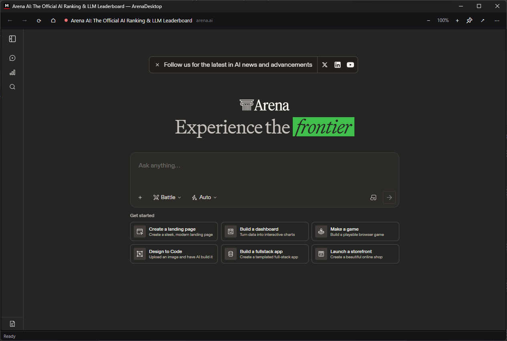

# ArenaDesktop

A native Windows desktop client for [Arena](https://arena.ai) — the AI model battle and leaderboard platform (formerly LMArena).

> ArenaDesktop is an independent open-source project. It is not made by, endorsed by, or affiliated with Arena Intelligence, Inc. "Arena" is their product; this app simply displays arena.ai in a native window.

## TL;DR

Arena has no Windows app, so this is one: a small native program that opens arena.ai in its own window, keeps you signed in, and lives in the system tray. Think of it like giving a website its own house key instead of visiting through the browser every time. It adds the desktop touches a tab can't — one-jump navigation to every part of Arena (Battle, Direct Chat, Side by Side, the Leaderboard, Agent, Image, Code, Video, Web Search), a command palette on **Ctrl+K** that reaches everything the menus do, downloads with progress, multiple sign-in profiles, Battle Lab and the prompt pad for the prompts you keep and the ones you don't, a settings window, and in-app updates. Free, open source (MIT), no telemetry, and nothing is ever injected into or read from the Arena page. You need Windows 10/11 on x64 and the WebView2 Runtime (usually already installed). Download the installer from [Releases](../../releases/latest) and run it.

## What you get

- **A real app, not a tab** — its own window, taskbar icon, and Alt-Tab entry; no browser chrome competing for space.
- **Three window layouts** — arrange the window's own chrome as **Standard** (the classic toolbar and status bar), **Compact Focus** (a slim toolbar and a small floating status pill, so the Arena page gets the extra height), or **Left Rail** (navigation and the Arena modes in a slim rail down the left edge, with Settings and the ⋯ menu at its foot). Pick in Settings → Appearance & toolbar or from the ⋯ menu; new installs start in Compact Focus, and a layout you save is always kept.
- **Pinned mode & this session** — pin the mode you use most (⋯ → **Navigate** → *Pin this mode*) and the status bar carries a one-click jump back to it; the ⋯ menu's **View** → *This session…* window counts what the run has done — time on Arena, pages, mode jumps, downloads, prompts copied — in memory only, saved nowhere. The ⋯ menu also gains **View** → **Zoom presets** (50–200%) and the find bar (Ctrl+F) gains **Whole word** and **Match case**.
- **Arena modes, one jump away** — Battle, Direct Chat, Side by Side, the Leaderboard, Agent, Image, Code, Video, and Web Search from the ⋯ menu's *Arena modes*, the tray menu, the taskbar Jump List, Ctrl+1…Ctrl+9, the command line, and `arenadesktop://` links. Each one is its own page on arena.ai (addresses verified on the live site); the model used inside Direct Chat and Side by Side is picked at the top of those pages.
- **Stay signed in** — a dedicated WebView2 profile on your PC keeps your Arena session between launches, and the app reopens the last page you were on.
- **Tray support** — the tray menu runs the whole app while it's hidden: Open, Arena modes, Quick ask, New window, Reload, Downloads, Settings, Switch profile, a web-view status line, and Exit. Closing the window minimizes to the tray by default; after a while hidden the web view can suspend to free memory (never during downloads or after the microphone has been used). A global hotkey (Ctrl+Alt+A, changeable) shows or hides the app from anywhere.
- **Battle Lab** — a side pane beside the Arena page for running Battle prompts in an organised way (⋯ menu → Tools → Battle Lab, the tray menu, `--battle-lab`, `arenadesktop://battle-lab`, or Ctrl+Shift+B), so a prompt can be read while you write the battle it belongs to. The pane reflows to fit — three columns in a wide window, two with the journal underneath in a normal one, one tabbed column when it is narrow: a searchable prompt library grouped by category, saved as you edit, with square-bracket blanks like [topic] that you fill in at copy time; "Copy prompt & open Battle" puts the finished text on the clipboard and brings the main window forward on the Battle page, ready to paste. A run queue lines prompts up in order, and a results journal keeps the winners you record by hand (A won / B won / Tie, with a note) — nothing is read from the Arena page. Four sample prompts are there on first run; edit or delete them freely.
- **Prompt pad** — a small scratchpad for the prompt you only want once (⋯ menu → Tools → Prompt pad…, the tray, `--prompt-pad`, `arenadesktop://prompt-pad`, or Ctrl+Shift+P). Write or paste the prompt, pick the Arena page beside the button, and **Copy & open** (it names the page) puts the text on the clipboard while that page comes forward with the keyboard in it, ready for your own Ctrl+V — nothing is typed into Arena and nothing is read from it. It remembers the last ten prompts on this PC (double-click one to reuse it, Forget to drop it), fills `[blank]` placeholders with Battle Lab's own dialog, asks before copying a prompt past 6,000 characters, and honours the opt-in clipboard clear. **Save to Battle Lab** (Ctrl+S) hands the prompt to the library instead — filed under a `Prompt pad` category, named after its first line, never added twice, and refused politely at the library's 200-prompt limit.
- **Command palette** — one searchable list of every command, on **Ctrl+K**, and since v0.14.0 five of them take an argument: `zoom 125`, `find cables`, `profile Work`, `mode side`, `saved cables` — the specific row goes to the top and Enter runs it (a malformed argument is a search, never a silent guess): the nine modes, every window, the three layouts and their cycle, focus mode, the five named zoom levels, the page actions, the log and support bundle, About, the app lock. Since v0.11.0 it covers the ⋯ menu line for line, and since v0.14.0 it also carries **Copy the next queued prompt** — the head of Battle Lab's run queue, paste-ready, without opening the pane. Since v0.14.0 it takes five arguments, including **`saved cables`**, which copies a saved Battle Lab prompt by name — a test fails if a menu item has neither a command nor a written reason not to have one — and a command that cannot work right now is hidden rather than refused. Type a few letters (the same prefix rule Settings and Help use), move with ↑ ↓, run with Enter. Each row shows the key that actually works, including any you remapped; it opens from ⋯ → Tools → Command palette…, the tray, `--palette` or `arenadesktop://palette`, and never while the app is locked. It is a second door onto commands the menus already run — nothing new touches the Arena page.
- **Field pass** — nine guided checks that prove the app on your PC (⋯ menu → Field pass…, Diagnostics, `--field-pass`, or `arenadesktop://field-pass`): layouts, Battle Lab, Arena mode jumps, a battle and its journal entry, downloads, the tray and hotkey, the app lock, profile switching, and the update check. Each check says what to do and what working looks like, with a button that opens the feature; you mark Pass, Problem, or Skip, add notes if you like, and everything is saved on this PC as you go. "Copy summary" puts the finished pass on the clipboard as plain text for a bug report.
- **Downloads with progress and control** — generated images, files and exports download in parallel with live progress %, estimated time remaining, and speed in the status bar; the taskbar button mirrors overall progress. The Downloads window is a small manager: pause/resume/cancel and retry per download, plus a searchable history with Open / Show in folder / Copy path / Open with… / Delete file and **Delete N selected…** for a multi-selection (the confirmation names the count and the total size) — sorted newest, oldest, largest, smallest or by name, filtered by size, and totalled for whatever the current filter shows. Settings checks the downloads folder can be written to and has room, and a finished download's tray balloon names the file, its size and where it landed. Folder, ask-where-to-save, name-collision behaviour and history size are all in Settings.
- **Multiple accounts** — profiles keep separate Arena sign-ins on one PC, each with its own session data — up to 32. Each can have its own zoom, downloads folder, accent colour and start page; switch from the ⋯ menu, the tray, or Settings, create a desktop shortcut per profile, or launch with `--profile <id>`.
- **Settings window** — one place (Ctrl+,) for startup behaviour, close-to-tray, zoom, downloads, updates and appearance, with a search box, export/import (plain or password-encrypted), reset-with-backup-first, and a one-screen setup wizard on first run.
- **Privacy & security** — clear cookies only, cache only, or all site data, per profile or all profiles, with the consequence stated first; a permissions manager and a counts-only site-data viewer (cookie values are never shown); an optional app lock (password/PIN — it guards the open app, it does not encrypt data on disk, and the app says so); an **idle auto-lock** that hides to the tray and locks after a chosen quiet period (off by default, and only when a password is set); a log viewer with an **Errors / Warnings / Info / Unparsed** filter that runs a redaction check before you share anything.
- **Recovers instead of dying** — a crash is *recorded*: the last run's ending shows in the status bar, three crashes in ten minutes offer **Restart in safe mode**, and Diagnostics lists the app's own data files with a **Repair data files…** button that backs each one up before resetting it.  if the page's engine crashes, or your connection drops or the PC sleeps mid-load, the app recovers once per incident (never a reload loop); a page that stops answering gets a banner offering Reload or Wait, never an automatic reload. Safe mode (`--safe-mode`, or hold Shift at launch) starts at the home page with no update check. An unexpected error says what failed and where, and **Copy details** hands over a report — exception, throwing frame, and a redacted log tail — instead of pointing at a file; Settings still opens when one of its panels cannot be read, naming that panel in a banner while the rest of the window works.
- **Updates, in-app** — the app checks GitHub Releases and can download an update with progress, verify its SHA-256 fingerprint against the release's published sums, and install only when you say so — never silently. Snooze, check frequency, Stable / pre-release channels, What's New, and rollback to the previous in-app-updated version are included. The check can be turned off in Settings.
- **Help that stays in the app** — offline Help & troubleshooting pages, a Diagnostics window with a one-click copyable report, a support-bundle export that is previewed file-by-file and uploaded nowhere, and guided microphone and notification tests.
- **Portable mode** — drop an empty `portable.txt` beside `ArenaDesktop.exe` in the zip build and settings, download history, and logs live in a `data` folder beside the exe. (Sign-in data stays in your user profile; see *Where things live*.)
- **Private by construction** — no telemetry, no accounts of its own, no data collection. The only files it writes are its settings, a rolling local log, and the WebView2 profile — all under your user profile, all deletable by you at any time.
- **Forgiving** — second launches wake the running window instead of opening a duplicate; a corrupted settings file is preserved as a backup and defaults are used; load failures explain themselves in plain words and offer a retry.

## Screenshots

Captures come from real runs on Windows — no mock-ups, no borrowed images. One is here so far (the main window); the rest of the list in [docs/screenshots/CAPTURE.md](docs/screenshots/CAPTURE.md) is owed and will be added as it is taken.



## Requirements

- Windows 10 or Windows 11, x64 (ARM64 builds were dropped in v0.7.0 — see *Known limitations*; an ARM64 PC runs the x64 build under emulation)
- The Microsoft Edge **WebView2 Runtime** — preinstalled on Windows 11 and most Windows 10 PCs. If it's missing, ArenaDesktop tells you and links you to Microsoft's installer.
- Nothing else: the download is **self-contained** — the .NET 10 runtime is bundled in, so there is no separate .NET install.

## Install

**Installer (recommended):** open the [latest release](../../releases/latest) and download the file named `ArenaDesktop-Setup-v<version>-x64.exe` — the version in the name is the release you are looking at, so the newest release always has the newest number (v0.18.0 at the time of writing). Run it. On a Windows-on-ARM PC this runs under emulation. It's a per-user install (no admin needed), with a Start Menu shortcut and an entry in Apps & Features for uninstalling. Uninstalling keeps your settings and sign-in data unless you choose to delete them when asked.

**Portable zip:** download `ArenaDesktop-v<version>-windows-x64.zip` from the same page, unzip anywhere, and run `ArenaDesktop.exe`. Every release also ships `SHA256SUMS.txt`, so you can check what you downloaded: `certutil -hashfile <file> SHA256` and compare.

Either way: the app is not code-signed, so Windows SmartScreen may warn on first run — choose **More info → Run anyway**.

## How to use it

1. Run ArenaDesktop and sign in to Arena in the window (Google or email, exactly as on the website).
2. Use Arena as normal — Battle is the home experience.
3. Jump around with the ⋯ menu's **Arena modes** (Ctrl+1 Battle, Ctrl+2 Direct Chat, Ctrl+3 Side by Side, Ctrl+4 Leaderboard, Ctrl+5 Agent, Ctrl+6 Image, Ctrl+7 Code, Ctrl+8 Video, Ctrl+9 Web Search).
4. Close the window to park it in the tray; press Ctrl+Alt+A or double-click the tray icon to bring it back.
5. Press F1 or ⋯ → **Help** → *Help & troubleshooting…* any time — the help works with no internet.

## Where things live

| What | Where |
| --- | --- |
| Settings | `%APPDATA%\ArenaDesktop\settings.json` |
| Download history | `%APPDATA%\ArenaDesktop\downloads.json` (names, sizes, dates, paths, and completed/failed state — never source URLs) |
| Diagnostic log | `%APPDATA%\ArenaDesktop\logs\arenadesktop.log` (URLs are logged host-and-path only, never with query strings) |
| Remembered prompts (prompt pad) | `%APPDATA%\ArenaDesktop\prompt-pad.json` (the last ten prompts, the unsent draft, and the page the pad opens; portable mode keeps it in `data`) |
| Battle Lab library, run queue and journal | `%APPDATA%\ArenaDesktop\battle-lab.json` (prompts with their categories, the queue order, and the results you recorded by hand) |
| Field pass | `%APPDATA%\ArenaDesktop\field-pass.json` (your Pass / Problem / Skip verdicts and notes) |
| Crash ledger | `%APPDATA%\ArenaDesktop\crash-history.json` (recent crashes and whether the last run ended in one — exceptions and where they were thrown, never page or prompt content) |
| Web profile (login session) | `%LOCALAPPDATA%\ArenaDesktop\WebView2` for the default profile; extra profiles get sibling folders (`WebView2-<id>`) |
| Downloads | Your Downloads folder, or the folder chosen in Settings |

In **portable mode**, Settings, Download history, and the Diagnostic log live under a `data` folder beside the exe instead of `%APPDATA%\ArenaDesktop` — and so do `battle-lab.json`, `prompt-pad.json` and `field-pass.json`. The Web profile stays in `%LOCALAPPDATA%` in this version — a portable copy does not carry your sign-in.

## Keyboard shortcuts

| Keys | Action |
| --- | --- |
| Ctrl+1 … Ctrl+9 | Battle / Direct Chat / Side by Side / Leaderboard / Agent / Image / Code / Video / Web Search |
| Alt+Left / Alt+Right | Back / Forward |
| Ctrl+F | Find in page |
| Ctrl+P | Print (⋯ menu also has Save as PDF…) |
| Ctrl+R or F5 | Reload |
| Ctrl+Plus / Ctrl+Minus / Ctrl+0 | Zoom in / out / reset to 100% |
| Ctrl+, | Open Settings |
| Ctrl+Shift+D | Open Downloads |
| Alt+Home | Go to Arena home |
| Ctrl+Shift+B | Show or hide the Battle Lab pane |
| Ctrl+Shift+P | Open the prompt pad |
| Ctrl+K | Command palette — every command in one searchable list |
| Ctrl+Shift+K | Cycle the window layout: Standard → Compact Focus → Left Rail |
| Ctrl+/ | Keyboard shortcuts — every shortcut grouped by area, searchable, click a row to copy its keys |
| F8 | Focus mode — hide the toolbar and status bar (Esc exits) |
| F11 | Full screen (Esc exits) |
| Ctrl+Alt+A | **Global** show/hide — works from any app (changeable in Settings) |

## Command line & links

Every capability in the window is also available from the command line — desktop shortcuts, the taskbar Jump List, and your own scripts all use this one surface. If ArenaDesktop is already running, a second launch hands its flags to the running app instead of opening a duplicate. While the app is locked, flags and links wait behind the lock — except `--exit-for-update`, which applies at once.

| Flag | What it does |
| --- | --- |
| `--profile <id>` | Start in (or switch to) the named profile |
| `--background` | Start hidden in the tray (how "Start with Windows" launches it) |
| `--battle` / `--direct` / `--side-by-side` / `--leaderboard` | Go to that Arena mode |
| `--mode <id>` | Go to a mode by id: `battle`, `direct`, `side-by-side`, `leaderboard` |
| `--home` | Open at the Arena home page |
| `--settings` | Open the Settings window |
| `--downloads` | Open the Downloads window |
| `--battle-lab` | Open the Battle Lab pane (prompt library, run queue, results journal) |
| `--field-pass` | Open the Field pass window (nine guided checks, your own verdicts) |
| `--prompt-pad` | Open the prompt pad (one prompt, copied for you and handed to the Arena page you pick) |
| `--palette` | Open the command palette (`--command-palette` is the same flag) |
| `--ask` / `--dictate` | Quick ask: show the window with the Arena page focused, ready to type (`--dictate` is kept as an alias) |
| `--safe-mode` | Start at the home page with no automatic update check |
| `--help` / `--version` | Show usage / the app version and exit |
| `--exit-for-update` | Ask the running instance to close so an update can install (the installer uses this, then reopens the app); applies at once, even while locked, and just exits when nothing is running |

Links work the same way: `arenadesktop://open`, `arenadesktop://home`, `arenadesktop://settings`, `arenadesktop://downloads`, `arenadesktop://battle-lab`, `arenadesktop://field-pass`, `arenadesktop://prompt-pad`, `arenadesktop://palette`, `arenadesktop://help`, `arenadesktop://profile/<id>`, `arenadesktop://battle`, `arenadesktop://direct`, `arenadesktop://side-by-side`, `arenadesktop://leaderboard`. That's the complete list, on purpose: a link can never carry a web address or open anything else.

## Building from source

Requires the .NET 10 SDK (see `global.json`).

```powershell
dotnet restore ArenaDesktop.sln
dotnet build ArenaDesktop.sln -c Release
dotnet test tests\ArenaDesktop.Core.Tests -c Release
dotnet publish src\ArenaDesktop\ArenaDesktop.csproj -c Release -r win-x64 --self-contained true
```

Architecture: `ArenaDesktop.Core` holds all testable logic (URL policy, Arena modes, settings, profiles, zoom, update checks, paths, logging) as plain .NET 10 with no Windows dependencies; the WPF app in `src\ArenaDesktop` is a thin shell over Microsoft's WebView2 control. See [DECISIONS.md](DECISIONS.md) and [KNOWN_LIMITATIONS.md](KNOWN_LIMITATIONS.md).

## Tests

The gate before any change is published: `dotnet build ArenaDesktop.sln -c Release` with zero errors and zero warnings, and the **full** Core test suite passing (never a filtered subset). CI runs the build and the whole suite on a Windows runner for every pull request, publishes the x64 build, and starts the published exe once (`--smoke-test`) to prove the window constructs and WebView2 initialises; tagging `v<version>` runs the same gate again before anything is published. The suite is the app's own rules pinned as tests — URL policy, settings and profiles, the update checks, the layouts, Battle Lab, the prompt pad, the palette — plus guards that fail on documentation drift.

## Troubleshooting

- **Sign-in keeps looping** — open ⋯ → **Help** → *Help & troubleshooting…* → "Arena keeps asking me to sign in" (works offline).
- **Arena won't load** — the failure screen says which kind of failure it was (offline, DNS, certificate…) and offers a retry; `--safe-mode` starts clean at the home page.
- **WebView2 Runtime missing** — the app tells you and links to Microsoft's installer.
- **Forgot the app-lock password** — the Help page "I forgot my app password" spells out the tested recovery.

## Security, privacy & network behaviour

ArenaDesktop talks to the network only to display arena.ai (and its sign-in providers) and, if update checks are on, to ask GitHub Releases whether a newer ArenaDesktop exists. It collects nothing, sends no telemetry, and never uploads your prompts, files or settings anywhere. Full details are in the Settings window's Privacy & security section and in [KNOWN_LIMITATIONS.md](KNOWN_LIMITATIONS.md).

## Limitations and known issues

See [KNOWN_LIMITATIONS.md](KNOWN_LIMITATIONS.md). In short: Windows runtime behaviour is Unverified until the release checklist has been run on a real Windows machine; Direct Chat and Side by Side are selected in Arena's own page; portable mode does not carry sign-ins; the app is unsigned; x86 (32-bit) builds are not shipped in this version.

## How complete is it?

Three documents are kept for this question rather than one paragraph here:

- **[QUALITY.md](QUALITY.md)** — the current scorecard, scored from evidence, with each row naming what would raise it (31/40 as of v0.16.0). The short version: the build, the full test suite and the released binary's start-up are verified on a Windows runner; interactive behaviour is not, because no on-machine pass has been recorded yet.
- **[KNOWN_LIMITATIONS.md](KNOWN_LIMITATIONS.md)** — what the app deliberately does not do, and why, in plain language.
- **[RELEASE_CHECKLIST.md](RELEASE_CHECKLIST.md)** — the on-machine pass that would turn "Unverified" into a recording, item by item.

Release notes for each published version are in [docs/release-notes](docs/release-notes) (and in the app's What's New on first launch); every change is in [CHANGELOG.md](CHANGELOG.md); every decision worth arguing about is in [DECISIONS.md](DECISIONS.md).

## Contributing

Issues and pull requests are welcome. Keep changes small and focused, put testable logic in `ArenaDesktop.Core` with tests, and run the project gate before opening a PR (see [AGENTS.md](AGENTS.md)). By contributing, you agree your work ships under the project's MIT license.

## License

MIT — see [LICENSE](LICENSE).
